<b>Software Engineering Student | CEO @ Codemic | Problem Solver | Creative Tech Enthusiast</b>

  

  

 

 

## About Me

- BSc in Software Engineering at Daffodil International University (SWE-43)
- CEO @ Codemic, a Bangla-language programming education platform
- Built the EJN Website, a study resource hub for DIU SWE students
- Always curious about learning new things and solving problems
- Love joining hackathons and competitions to build fast and learn faster
- Experienced in teamwork, collaboration and leading university project teams

 

## Skills

**Programming Languages**

**Core Concepts**

- Object-Oriented Programming (OOP)
- Problem Solving
- Data Structures & Algorithms

**Web Dev**

**Tools & Deployment**

**Other Tools**

- Canva
- MS Word
- PowerPoint

 

## GitHub Stats

 

 

## Projects

### Web Projects

| Project | What it is | Links |
| ------- | ---------- | ----- |
| **Codemic Website** | Bangla-language C programming education platform | [Live](https://codemicltd.netlify.app/) |
| **Codemic LMS** | Student dashboard for Codemic: courses, assignments, contests, leaderboard (in progress) | Coming soon |
| **EarthTwin** (Team PLANEX) | NASA Space Apps entry that finds Earth analogs for Moon base and Mars sites | Coming soon |
| **EJN Website** | Study resource hub for DIU SWE students | [Live](https://ejn-website.netlify.app/) |
| **Student Study Planner** | Task tracking, study planner, exam reminders, Pomodoro, GPA calculator | [Live](https://es-ratt.github.io/student-study-planner) · [Repo](https://github.com/es-ratt/student-study-planner) |
| **Food Axis** | Restaurant operations platform (system analysis & design capstone) | Coming soon |
| **VESTIS (Digital Closet)** | Single-file app to organize clothes and generate random outfits | Coming soon |
| **Task API** | Node.js CRUD API with 3-layer architecture and Dockerized Postgres | [Repo](https://github.com/es-ratt/task-api-layered-architecture) |
| **FlyRank Image Relevance** | Image relevance and auto-tagging full-stack capstone app | [Repo](https://github.com/es-ratt/flyrank-capstone-image-relevance) |

### Older Projects

- Java: University Management System, SuperMarket Billing System
- C: Employee Management System and various C programming projects

 

## Interests

- Problem Solving
- Team Leadership
- Creative Development
- Learning New Technologies
- Hackathons

## Hobbies

- Traveling
- Photography
- Exploring New Foods

 

<i>"Code. Learn. Build. Repeat."</i>

